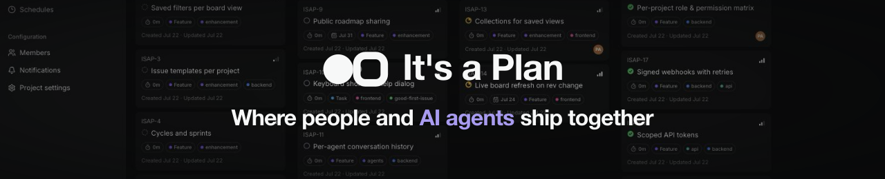
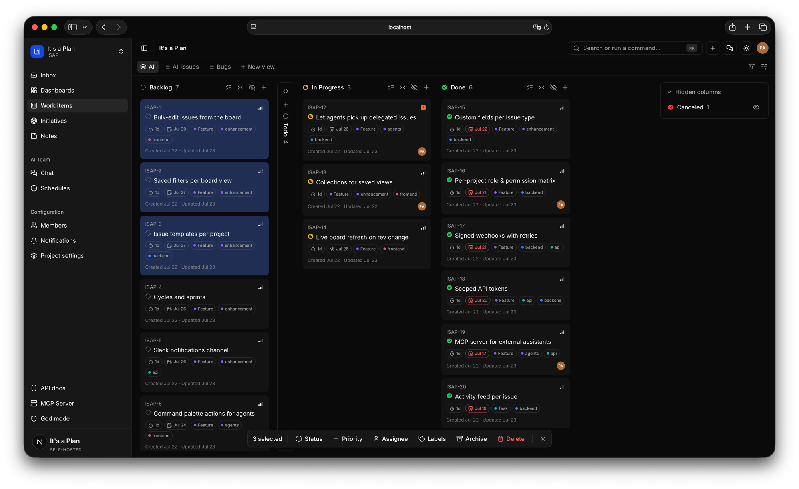

<div align="center">



### Open-source project management and issue tracking, compatible with Linear

Self-hosted, open-source project management and issue tracking that follows Linear's model
and serves Linear's GraphQL API, so Linear tools and the `@linear/sdk` work against your own
instance.

If It's a Plan looks useful to you, star the repo ⭐ — it helps other people find it.

[Website](https://itsaplan.dev) · [Discussions](https://github.com/croffasia/itsaplan/discussions) · [Contributing](CONTRIBUTING.md) · [Security](SECURITY.md)

[](LICENSE)
[](https://github.com/croffasia/itsaplan/actions/workflows/ci.yml)
[](https://github.com/croffasia/itsaplan/stargazers)
[](https://github.com/croffasia/itsaplan/commits/main)



</div>

## About

It's a self-hosted, open alternative to Linear. You run it on your own server and database.

- **Own your stack.** Your server, your database. No per-seat fees, no lock-in.
- **Linear-compatible.** Linear's data model, its GraphQL API and its webhook format.
- **Automate anything.** Drive it through the GraphQL API, MCP, and signed webhooks.

Heads-up: this is under active development. Expect breaking changes before the first
stable release.

## Features

**Track work**

- Issues with priority, estimates on each team's scale, due dates, labels, sub-issues,
  relations, templates, attachments, documents and threaded comments with reactions
- Teams with their own workflow states, labels, cycles, automations and webhooks; public or
  private
- List, board, timeline and calendar layouts with grouping and Linear's orderings; saved
  views, My issues, favorites and an inbox

**Plan**

- Projects with milestones, updates, health, progress, dependencies and a projects
  timeline
- Initiatives, automatic cycles, and release tracking synced from CI
- Insights and dashboards with CSV export

**Outside feedback**

- Feedback requests and the people who give them, optionally grouped into customers
- A client portal where outside people vote, comment and suggest, and intake forms
- Email updates to requesters when what they asked for changes or ships

**Run it**

- Linear's GraphQL API at `/graphql`, personal API keys, OAuth applications, the agent API,
  an MCP server and webhooks in Linear's format
- Sign-in by emailed link, passkey or Google; owner, admin, member and guest roles; an audit
  log
- Workspace settings: name, sign-in methods, upload types, and who may create teams,
  manage labels and invite
- Imports from GitHub, GitLab, Gitea, Forgejo, Jira CSV and any CSV

[Linear compared with It's a Plan](docs/linear-comparison.md) lists, area by area, what
matches Linear and what is not built yet.

## Quick start

Requirements: Docker with the Compose plugin.

```bash
git clone https://github.com/croffasia/itsaplan.git
cd itsaplan
cp .env.example .env
# In .env, set API_URL and APP_URL to your public origins, and generate each secret
# (POSTGRES_PASSWORD, BETTER_AUTH_SECRET, WORKER_INTERNAL_TOKEN, S3_ACCESS_KEY_ID,
# S3_SECRET_ACCESS_KEY) with: openssl rand -hex 32
docker compose up -d --build
```

This builds and starts Postgres, RustFS file storage, the API, the worker and the web app.
Open `APP_URL` and sign in: the first account becomes the workspace owner. Until an email
provider is set, sign-in links are written to the API log
(`docker compose logs api | grep "magic link"`).

[Self-hosting with Docker](docs/self-hosting.md) covers the reverse proxy, email, upgrades,
backups and Coolify.

## Documentation

| Page                                                      | For                                                     |
| --------------------------------------------------------- | ------------------------------------------------------- |
| [Self-hosting with Docker](docs/self-hosting.md)          | installing, configuring, upgrading and backing up       |
| [GraphQL API](docs/graphql-api.md)                        | the API, the Linear SDK, OAuth, webhooks and MCP        |
| [Linear compared with It's a Plan](docs/linear-comparison.md) | what matches Linear and what is missing             |
| [Release sync from CI](docs/release-sync.md)              | connecting CI to release tracking                       |
| [GitHub issue import setup](docs/github-import-setup.md)  | enabling the GitHub importer                            |
| [CONTRIBUTING.md](CONTRIBUTING.md)                        | developing, testing and opening pull requests           |
| [AGENTS.md](AGENTS.md)                                    | rules for coding agents working in this repository      |

## Built with

| Layer     | Technology                                               |
| --------- | -------------------------------------------------------- |
| Runtime   | [Bun](https://bun.sh) + [Turborepo](https://turbo.build) |
| Backend   | [Elysia](https://elysiajs.com/)                          |
| Frontend  | [Next.js](https://nextjs.org/) App Router, SSR           |
| UI        | [shadcn/ui](https://ui.shadcn.com/) + Tailwind v4        |
| Auth      | [better-auth](https://better-auth.com/)                  |
| Database  | [Drizzle](https://orm.drizzle.team/) + PostgreSQL        |
| Storage   | S3-compatible object store (RustFS)                      |

```
apps/api        Elysia HTTP API, mounts better-auth at /api/auth/*
apps/web        Next.js app, server-side rendered
apps/worker     webhook and notification delivery, auto-archive, cycle upkeep
packages/db     Drizzle client, schema, migrations
packages/auth   better-auth server instance
packages/mailer SMTP and Resend transport
```

The web app never imports the packages directly, it talks to the API over HTTP.

## More from us

**[Vibe Code Kit](https://vibecodekit.dev)** — a Claude Code plugin with 20+ expert skills
that turn AI slop into senior-level code. It teaches your AI agent professional development
and design practices, so you ship production-ready code on the first try. Works with Claude
Code, Codex, Gemini CLI, and Cursor.

It's a Plan is built with it — the code you are reading is the proof.

## Contributing

Issues and pull requests are welcome — bug fixes, features, docs, all of it. Start with
[CONTRIBUTING.md](CONTRIBUTING.md). It covers the setup, the conventions, and how a change
gets merged. Be kind; we follow a [Code of Conduct](CODE_OF_CONDUCT.md).

Not ready to contribute code? [Star the repo](https://github.com/croffasia/itsaplan) and share
it — it is the simplest way to help the project grow.

## Security

Found a vulnerability? Report it privately through
[GitHub Security Advisories](https://github.com/croffasia/itsaplan/security/advisories/new),
not a public issue, so we can fix it first. Details in [SECURITY.md](SECURITY.md).

## License

Copyright © 2026 VIBE DEV SPACE LLC.

[AGPL-3.0](LICENSE). Running a modified version as a network service means publishing
your changes under the same license.
